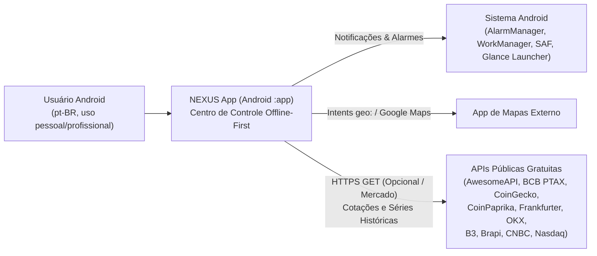
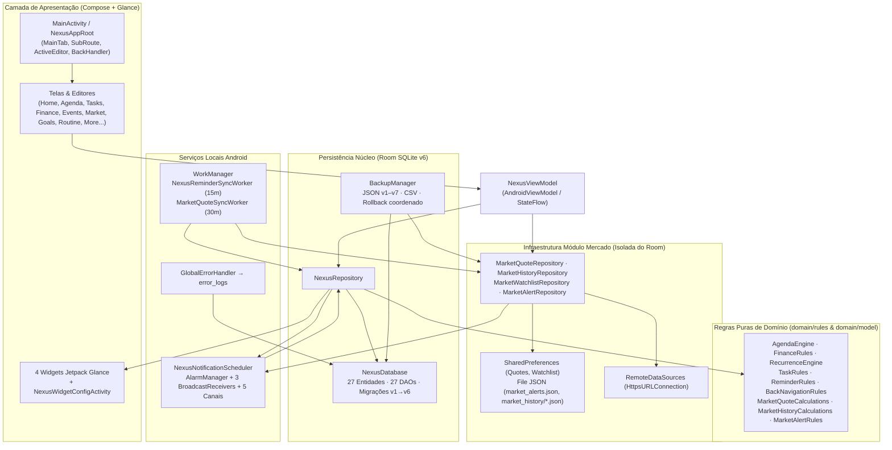

# 03 — Arquitetura de Engenharia (`NEXUS Architecture`)

> **Base verificada:** inspeção direta de `NexusApplication.kt`, `MainActivity.kt`, `NexusViewModel.kt`, `NexusRepository.kt`, `domain/rules/*`, `data/db/*`, `data/market/*`, `data/backup/*`, `notifications/*`, `widgets/*`, `app/build.gradle.kts`, `settings.gradle.kts` e `AndroidManifest.xml`.

---

## 1. Visão Macro e Estilo Arquitetural

O NEXUS é um aplicativo Android nativo em **módulo Gradle único (`:app`)**, estruturado em uma arquitetura **reativa, offline-first e orientada a estado** (MVVM + Repository + Domain Rules puras + Stores isolados para Mercado/Widgets), sem uso de frameworks de DI (Hilt/Koin) e sem backend remoto.

### Stack Tecnológica Confirmada
- **Linguagem / Runtime:** Kotlin `2.1.0`, Java `17`, `kotlinx-coroutines-android:1.9.0`, `kotlinx-serialization-json:1.7.3`.
- **Android SDK:** `minSdk = 26`, `targetSdk = 35`, `compileSdk = 35`.
- **UI:** Jetpack Compose (BOM `2024.12.01`), Material 3, `material-icons-extended`, gráficos nativos em `Canvas` (`ui/components/charts/`).
- **Persistência:** Room `2.6.1` (`SQLite`, KSP `2.1.0-1.0.29`, `DATABASE_VERSION = 6`), `SharedPreferences`, arquivos JSON locais em `filesDir`.
- **Background & Sistema:** `WorkManager` `2.10.0`, `AlarmManager`, `BroadcastReceiver`, Jetpack Glance `1.1.1`.
- **Rede (apenas Mercado):** `java.net.HttpURLConnection` / `HttpsURLConnection` nativa (sem Retrofit/OkHttp).
- **Observação sobre dependência ociosa:** `androidx.navigation:navigation-compose:2.8.5` está declarada no `app/build.gradle.kts` e `gradle/libs.versions.toml`, porém **não é utilizada** no código.

---

## 2. Diagramas C4 (Confirmados no Código)

### C4 Nível 1 — Contexto do Sistema

- **Sem servidor próprio:** nenhuma comunicação com Firebase, nuvem NEXUS ou autenticação externa.
- **Soberania de arquivos:** importação/exportação `.json`, `.csv` e `.txt` passam exclusivamente pelo seletor do Android (**SAF**).

### C4 Nível 2 — Contêineres Internos do App (`com.nexus.app`)

### C4 Nível 3 — Estrutura de Pacotes e Componentes Reais

| Pacote (`com.nexus.app.*`) | Responsabilidade | Principais Arquivos |
| --- | --- | --- |
| `(raiz)` | Inicialização, container manual de dependências (`AppContainer`) e shell Compose | `NexusApplication.kt`, `MainActivity.kt` |
| `core` | Data/hora em `America/Sao_Paulo`, moeda BRL e captura global de crashes | `DateTimeUtils.kt`, `GlobalErrorHandler.kt` |
| `domain.model` | 19+ enums globais (`NexusEnums`), DTOs de UI (`DomainModels`) e modelos/regras do Mercado | `NexusEnums.kt`, `DomainModels.kt`, `MarketQuoteModels.kt`, `MarketHistoryModels.kt`, `MarketAlertModels.kt` |
| `domain.rules` | Motores e funções puras testáveis em JVM sem Contexto Android | `AgendaEngine.kt`, `FinanceRules.kt`, `RecurrenceEngine.kt`, `TaskRules.kt`, `ReminderRules.kt`, `BackNavigationRules.kt` |
| `data.db` | Banco Room, TypeConverters, 27 entidades, 27 DAOs e migrações `1→6` | `NexusDatabase.kt`, `NexusMigrations.kt`, `NexusTypeConverters.kt`, `entity/NexusEntities.kt`, `dao/NexusDaos.kt` |
| `data.repository` | Orquestração transacional SQLite, fluxos `Flow` reativos, agendamento de lembretes e sync widgets | `NexusRepository.kt` (~4.914 linhas) |
| `data.market` | Repositórios, stores (`Prefs`/`File`), workers e clientes HTTP públicos do Mercado | `MarketQuote*.kt`, `MarketHistory*.kt`, `MarketWatchlist*.kt`, `MarketAlert*.kt` |
| `data.backup` | Exportação/validação/restauração JSON `v1..v7` (Room + `marketConfig`) e CSV financeiro | `BackupModels.kt`, `BackupManager.kt` |
| `notifications` | 5 canais Android O+, agendamento `AlarmManager`, receivers de ação/boot e worker de lembretes | `NexusNotificationChannels.kt`, `NexusNotificationScheduler.kt`, `NexusBroadcastReceivers.kt`, `NexusReminderSyncWorker.kt` |
| `widgets` | 4 AppWidgets Glance responsivos, tema dual dia/noite, config por ID e `NexusWidgetUpdater` (`Mutex`) | `MyDayGlanceWidget.kt`, `MyTasksGlanceWidget.kt`, `FinanceGlanceWidget.kt`, `NexusSummaryGlanceWidget.kt`, `NexusWidgetConfig*.kt`, `NexusWidgetTheme.kt`, `NexusWidgetUpdater.kt` |
| `ui` | ViewModel único, tema, componentes compartilhados, gráficos Canvas, mapper do Mercado e telas | `NexusViewModel.kt`, `theme/NexusTheme.kt`, `components/*`, `market/MarketPresentation.kt`, `screens/*` |

---

## 3. Fluxo de Injeção de Dependências (`AppContainer`)

Em `NexusApplication.onCreate()`:
1. Garante criação dos 5 canais de notificação (`NexusNotificationChannels.ensureChannelsCreated`).
2. Inicializa `AppContainer(this)` com inicialização `by lazy`:
   - `database` (`NexusDatabase.build`)
   - `notificationScheduler` (`NexusNotificationScheduler`)
   - `marketAlertRepository` (com callback disparando `notificationScheduler.showMarketAlertNotification`)
   - `marketQuoteRepository` (com callback avaliando `marketAlertRepository.evaluateQuotes(freshQuotes)`)
   - `marketHistoryRepository`, `marketWatchlistRepository`
   - `backupManager(database, marketWatchlistRepository, marketAlertRepository)`
   - `repository(database, backupManager, notificationScheduler, onDataChanged = { NexusWidgetUpdater.updateAllWidgets(...) })`
3. Agenda workers periódicos: `NexusReminderSyncWorker` (15 min) e `MarketQuoteSyncWorker` (30 min, exigindo `NetworkType.CONNECTED`).
4. Registra `GlobalErrorHandler` encadeado com o `UncaughtExceptionHandler` padrão.

---

## 4. Arquitetura de Navegação (Sem `NavHost`)

O app utiliza **navegação puramente por estado Compose** dentro de `NexusAppRoot` (`MainActivity.kt`):
- **Abas principais (`MainTab` em `BOTTOM_NAV_TAB_ORDER`):** `TASKS` → `AGENDA` → `HOME` (padrão) → `FINANCE` → `EVENTS`.
- **Sub-rotas (`SubRoute`):**
  - `TOP_LEVEL_SUBROUTE`: `MoreMenu`, `GlobalSearch`, `Market`, `MarketAssetDetail(assetCode)`, `DashboardCustomization`, `RoutineAssistant(initialTabIndex)`.
  - `MORE_CHILD_SUBROUTE`: `Planning(initialGoalId)`, `QuoteLibrary`, `WidgetsHub`, `Settings`, `Backup`, `Diagnostics`.
- **Editores e Modais (`ActiveEditor`):** `QuickAddChooser`, `TaskEditor`, `AppointmentEditor`, `ProjectEditor`, `EventEditor`, `TransactionEditor`, `CreditCardEditor`, `InstallmentEditor`, `RecurringEditor`, `LoanEditor`, `LoanPayment`, `DeclaredBalance`, `BudgetEditor`, `FinancialGoalEditor`.
- **Tratamento do Botão Voltar (`BackHandler`):** integrado a `resolveBackAction(BackNavigationState)` (`BackNavigationRules.kt`) monitorando `activeEditorDirty`.
- **Deep-Links (`nexus://open/...` e Extras de Intent):** recebidos via `onCreate` / `onNewIntent` → `incomingIntentFlow` (`MainActivity.kt`) e roteados para abas, sub-rotas ou editores/ativos específicos (ex.: toque em notificação de alerta do Mercado abre `SubRoute.MarketAssetDetail(assetCode)`).

---

## 5. Estrutura Mista do Repositório Raiz

O diretório raiz contém duas realidades distintas que **não devem ser confundidas**:
1. **Projeto Android real (produto NEXUS):** `/app/`, `/gradle/`, `/build.gradle.kts`, `/settings.gradle.kts`, `/gradle.properties`, `/.github/workflows/android-build.yml` e `/docs/`.
2. **Arquivos de wrapper do ambiente Google AI Studio:** `package.json`, `vite.config.ts`, `tsconfig.json`, `index.html`, `src/`, `public/`, `metadata.json`, `bun.lock`. Eles existem apenas por requisito de runtime da plataforma host e **não compõem o aplicativo Android**.

> **Nota sobre Gradle Wrapper:** existe `gradle/wrapper/` no repositório, mas os scripts executáveis `./gradlew` e `gradlew.bat` não estão presentes na raiz; o pipeline de CI (`.github/workflows/android-build.yml`) utiliza `setup-gradle@v4` e invoca `gradle :app:testDebugUnitTest :app:assembleDebug` diretamente.
