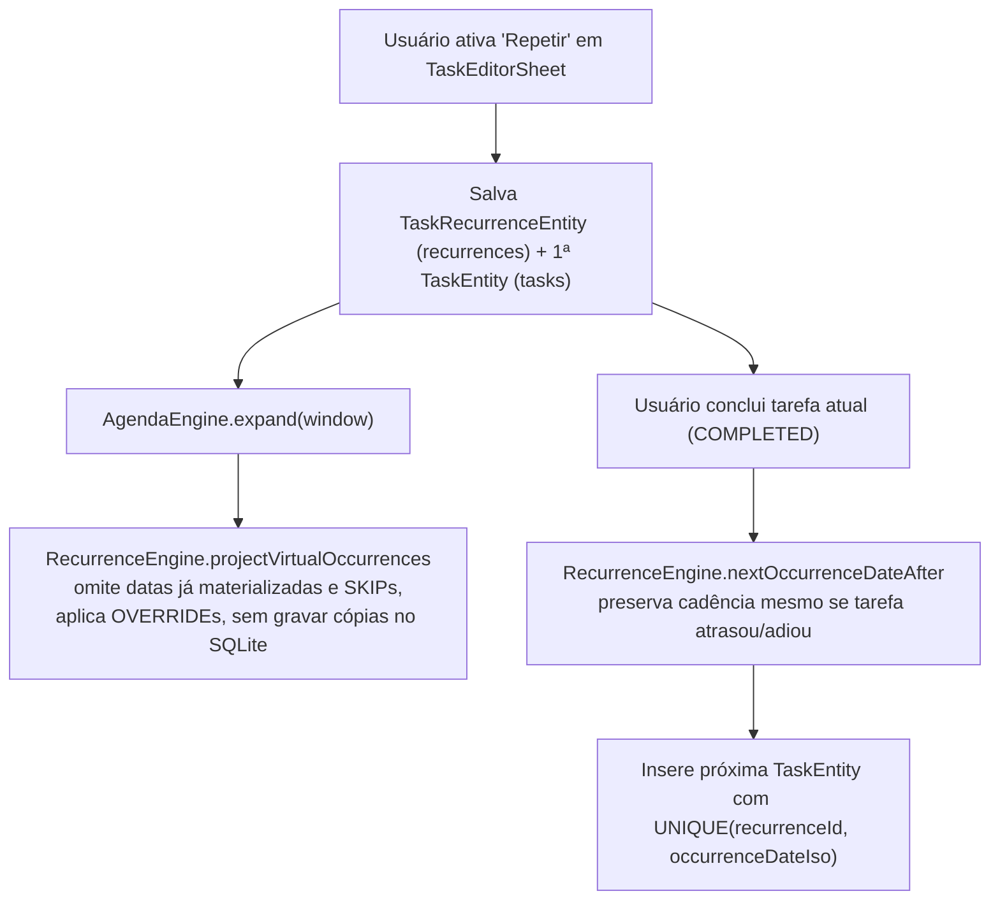
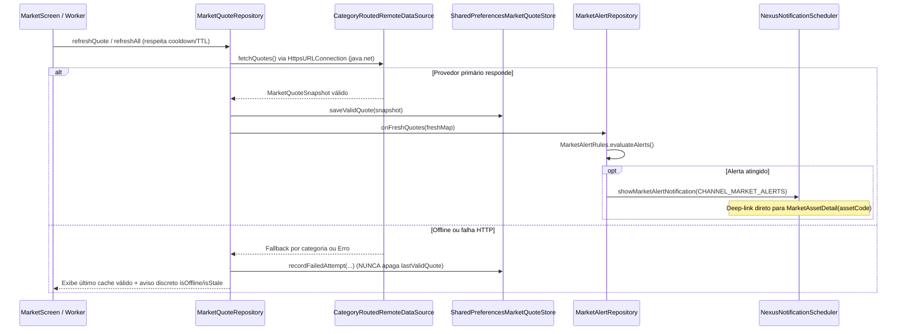

# 05 — Fluxos, Regras de Negócio e Comportamentos (`NEXUS Flows`)

> **Finalidade:** documentar ponta a ponta os fluxos reais entre UI, `NexusViewModel`, regras puras, repositórios, persistência, workers, notificações e widgets.

---

## 1. Fluxo de Navegação, Criação Rápida e Descarte Seguro

1. Usuário toca no `FAB` (`+`) ou `"Criar primeiro registro"` → `activeEditor = ActiveEditor.QuickAddChooser`.
2. Seleciona Tarefa, Compromisso, Lançamento, Evento ou Projeto → abre o editor respectivo pré-preenchido pelo contexto (ex.: data selecionada na Agenda, `eventId` quando aberto de dentro de um Evento, `taskId` quando aberto via `"Registrar gasto"`).
3. Ao tentar fechar/voltar:
   - `BackHandler` consulta `resolveBackAction(BackNavigationState)` (`BackNavigationRules.kt`) usando `activeEditorDirty`.
   - Se `hasOpenEditor && activeEditorDirty == true`, exibe `ConfirmDiscardChangesDialog` (`"Continuar editando"` / `"Descartar"`).
   - Caso contrário, fecha editor → volta de subtela (`MORE_CHILD_SUBROUTE → MoreMenu`, `TOP_LEVEL_SUBROUTE → None`) → retorna à aba `HOME` → permite saída do sistema.

---

## 2. Fluxo Tarefa ↔ Projeto ↔ Objetivo Pessoal

1. Uma `TaskEntity` pode apontar opcionalmente para `projectId`, `categoryId`, `eventId`, `goalId` e `recurrenceId`.
2. Ao concluir/reabrir a tarefa (`setTaskStatus` / `toggleTaskCompletion`):
   - Atualiza `status` e `completedAt` em `tasks`.
   - Cancela ou reagenda o lembrete em `reminders` + `AlarmManager`.
   - Fluxos `Flow` atualizam automaticamente `ProjectWithProgress` (`completedTasks / totalTasks`) e `PersonalGoalWithDetails` (no modo `AUTO`, combina marcos, tarefas ligadas e projetos ligados).
   - Dispara `NexusWidgetUpdater.updateAllWidgets(context)`.

---

## 3. Fluxo Tarefa → Gasto (`"Registrar gasto"`)

1. Em `TaskEditorSheet`, tocar em `"Registrar gasto"`:
   - Se a tarefa é nova ou possui alterações não salvas (`task == null || hasUnsavedChanges`), solicita confirmação para salvar a tarefa antes (`showSaveForExpenseConfirm`).
   - Abre `TransactionEditorSheet` pré-preenchido com `type = EXPENSE`, `description = task.title`, `taskId = task.id`, `eventId = task.eventId`, `projectId = task.projectId`, `requireExplicitPaymentMethod = true` e `categoryId = AgendaEngine.suggestExpenseCategoryId(...)`.
2. Usuário informa **valor** e **forma de pagamento** (e ajusta demais campos se desejar) e salva.
3. Efeitos observáveis:
   - Na tarefa (`TaskWithDetails`): soma e exibe `"Gasto: R$ X"` (`totalExpenseCents`).
   - No Financeiro (`TransactionWithDetails` / `TransactionRowCard`): exibe `"Tarefa: <título>"`.
   - Na Agenda (`AgendaEngine`): segue regra financeira padrão (despesa pendente sem fatura aparece no vencimento; liquidada só aparece se `showPaid = true`; cartão entra na fatura).

---

## 4. Fluxo de Tarefa Recorrente (`RecurrenceEngine` + `AgendaEngine`)

- **Editar/Excluir ocorrência:** `TaskScopeConfirmDialogs` pergunta `"Só esta ocorrência"` (cria `RecurrenceExceptionEntity` `OVERRIDE` ou `SKIP`) vs `"Toda a série"` (atualiza/desativa `TaskRecurrenceEntity`).
- **Materialização sob demanda na Agenda:** tocar em uma ocorrência virtual na `AgendaScreen` dispara `onOpenVirtualRecurringTask(recurrenceId, occurrenceDateIso)` que materializa/abre aquela ocorrência específica.

---

## 5. Fluxo Financeiro: Compra no Cartão → Fatura → Quitação (Zero Duplicação)

1. Despesa criada com `PaymentMethod.CREDIT_CARD` e `creditCardId != null`:
   - `ensureStatementForCardAndDate` compara o dia da compra com `card.closingDay` (se `day > closingDay`, aloca para a competência do mês seguinte) e cria/obtém a `CreditCardStatementEntity` correspondente (`UNIQUE(creditCardId, yearMonth)`).
   - `TransactionEntity.statementId` recebe o `id` da fatura.
2. **Projeções:**
   - **Totais do mês e `DonutChart` (`FinanceRules`):** contabilizam a **compra original** na sua categoria e no mês de `dueAt ?: occurredAt`.
   - **`AgendaEngine`:** omite transações com `statementId != null` (`!isDirectAgendaBill`) e exibe apenas a **fatura** em aberto (`status != PAID && totalCents > 0`) no dia `statement.dueAt`.
3. **Pagamento da fatura (`payCreditCardStatement`):**
   - Atualiza todas as transações ligadas à `statementId` para `FinancialStatus.SETTLED` (com `settledAt`).
   - Marca a fatura como `StatementStatus.PAID` com `paidAt` e `paidAmountCents`.
   - Sincroniza `EventEntity.ticketStatus` se havia ingresso vinculado e cancela lembretes da fatura.
   - **Nunca cria segunda transação de despesa** e não distorce o gasto por categoria do mês.

---

## 6. Fluxo de Eventos e Obrigações de Ingresso

1. `saveEvent` grava `EventEntity` e avalia `ticketStatus`:
   - `FREE` ou `CANCELLED`: remove obrigações de ingresso não liquidadas (`isTicketObligation = true && status != SETTLED`).
   - Pago/Pendente com `installmentsCount > 1 && CREDIT_CARD`: cria/atualiza `InstallmentPurchaseEntity` + `N` `TransactionEntity` distribuídas nos cartões/faturas mensais (resto da divisão inteira na 1ª parcela).
   - Pago/Pendente único: cria/atualiza 1 `TransactionEntity` (`eventCostType = TICKET`, `isTicketObligation = true`, `status = SETTLED` se `BOUGHT/PAID`, senão `PENDING`).
2. Quitar qualquer parcela/transação de ingresso (`settleTransaction` ou `payCreditCardStatement`) recalcula automaticamente `EventEntity.ticketStatus` (`PARTIALLY_PAID` → `PAID`).
3. Custos extras criados com `eventId` somam em `EventWithDetails.estimatedTotalCostCents` (excluindo `CANCELLED`) e `paidTotalCostCents` (`SETTLED`).

---

## 7. Fluxo do Módulo Mercado: Cotações, Fallback, Histórico e Alertas

- **Conversão BRL informativa:** ativos cotados em `USD` (`SPX`, `IXIC`, `MELI`) mantêm o valor primário na unidade/moeda original (`pts` ou `US$`) e exibem conversão informativa em `R$` usando `MarketQuoteCalculations.convertUsdToBrl(price, usdBrlState)`.
- **Proteção anti-duplicação nos Alertas:**
  1. Quando dispara, o alerta muda imediatamente para `MarketAlertStatus.TRIGGERED`, `isActive = false` e grava preço, fonte e timestamp do disparo.
  2. Ao rearmar (`WAITING`) enquanto a cotação atual já satisfaz a condição, entra em `awaitingConditionReset = true` — só volta a poder disparar depois que o preço cruzar para o lado oposto do alvo (`isOppositeSideOfTarget`).
  3. Registra `lastEvaluatedQuoteFetchedAtEpochMs` para não reavaliar a mesma cotação em cache.
- **Histórico (`MarketHistoryRepository`):** usa deduplicação/coalescing em memória, gravação atômica por arquivo `(assetCode, range)` em `filesDir/market_history/`, omitindo `1D` para `USD-BRL` e `EUR-BRL`.

---

## 8. Fluxos de Rotina, Lembretes, Widgets e Erros

- **Lembretes:** `ReminderRules.resolveReminderSyncAction` preserva lembretes existentes intocados quando o usuário edita o registro sem mudar o prazo nem tocar no seletor de lembrete. `NexusNotificationScheduler` usa `AlarmManager.setExactAndAllowWhileIdle` (ou inexato se `!canScheduleExactAlarms()`) e respeita `quietHours` (adiando para o fim do silêncio em `America/Sao_Paulo`).
- **Ações de Notificação (`NexusNotificationActionReceiver`):** `Concluir` (tarefa), `Marcar pago` (lançamento), `Adiar 15m` (`snoozedUntil`), `Dispensar` (`DISMISSED`), `Marcar revisado` (rotina).
- **Widgets Glance:** atualizações serializadas por `Mutex` em `NexusWidgetUpdater`. No `MyTasksGlanceWidget`, tocar para concluir ativa confirmação em 2 passos com TTL de `15s` em `NexusWidgetConfigStore` e impede conclusão direta de tarefas `BLOCKED` ou terminais.
- **Tratamento de Erros e Crash:**
  - Falhas assíncronas em repositórios/workers usam `safeDbCall` / `runCatching`, registram em `error_logs` e mostram feedback amigável (nunca stack trace cru na UI).
  - Exceções não tratadas passam pelo `GlobalErrorHandler`, que grava `ErrorLogEntity` no Room (com timeout curto de proteção) antes de delegar ao `UncaughtExceptionHandler` padrão do Android.
